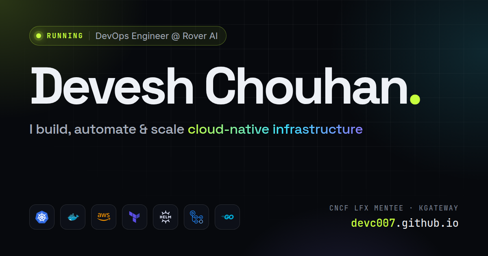

# devc007.github.io

Personal portfolio of **Devesh Chouhan**, DevOps Engineer at Rover AI and former CNCF LFX mentee at [kgateway](https://github.com/kgateway-dev/kgateway).

**Live:** https://devc007.github.io



## Highlights

- **Kubernetes-flavoured motion:** a `kubectl rollout` boot screen, a live terminal (`kubectl get jobs -n career`), and a hero canvas where packets hop across a cluster of nodes.
- **Skills orbit:** 18 tools on three rotating rings. Point at a skill group to light up its tools.
- **Live details:** uptime since joining Rover AI, IST clock, and the build SHA stamped in the footer by CI.
- **Scroll storytelling** with GSAP ScrollTrigger and SplitText, plus Lenis smooth scrolling.
- **Accessible and progressive:** readable without JavaScript, respects `prefers-reduced-motion`, and passes axe and html-validate.

## Stack

Plain HTML, CSS and JavaScript, with no build step.

| Part | Tool |
| --- | --- |
| Animation | [GSAP](https://gsap.com) 3.15 (ScrollTrigger, SplitText) |
| Smooth scroll | [Lenis](https://github.com/darkroomengineering/lenis) 1.3 |
| Fonts | Space Grotesk, Inter, JetBrains Mono (Google Fonts) |
| Tech logos | [Devicon](https://devicon.dev) |
| CI/CD | GitHub Actions → GitHub Pages |

## Project layout

```
index.html                  # all page content
404.html                    # "pod not found" page
assets/css/style.css        # design tokens, layout, effects
assets/js/main.js           # boot, intro, scroll animations, interactions
assets/js/network.js        # hero canvas (nodes + packets)
assets/vendor/              # GSAP + Lenis (pinned copies)
assets/icons/, logos/, img/ # logos, social preview, favicon
.github/workflows/deploy.yml
```

## Run locally

```bash
python3 -m http.server 8000
# open http://localhost:8000
```

## Deploy

Every push to `main` runs `.github/workflows/deploy.yml`:

1. Validate the HTML (`html-validate`) and check the JavaScript syntax.
2. Assemble `_site/` and stamp the commit SHA into the footer.
3. Publish to GitHub Pages.

## Edit the content

| To change | Edit |
| --- | --- |
| Text, jobs, projects, links | `index.html` |
| Rover AI start date (uptime) | `ROVER_START` in `assets/js/main.js` |
| Terminal lines in the hero | `SCRIPT` in `assets/js/main.js` |
| Colors, fonts, spacing | the `:root` tokens in `assets/css/style.css` |
| Link preview image | `assets/img/og.png` (1200×630) |

---

© Devesh Chouhan. Logos belong to their owners.
